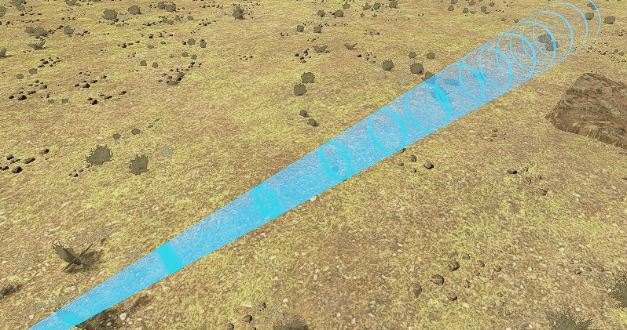

# CenterGlowWithScanline

中心发光 + 动态扫描线 shader（Shader 名：`Custom/CenterGlowWithScanline`）。

适合做 UI 光带、能量带、科技感扫描光效：中间实、两边虚，且光带上有沿长度方向流动的亮条纹。

## 效果预览



## 文件结构

```
UnityShader_CenterGlowWithScanline/
├── CenterGlowWithScanline.shader
└── Model/
    └── MD_sectorial plane/
        ├── sectorial_plane_02.mat   使用本 shader 的材质球
        └── sectorial_plane_03.fbx   该材质球所赋的模型
```

同步目标（Unity 运行时代码）：

```
Assets/
├── CenterGlowWithScanline.shader
└── Model/
    └── MD_sectorial plane/
        ├── sectorial_plane_02.mat
        └── sectorial_plane_03.fbx
```

## 使用方法

1. 新建材质，Shader 选 `Custom/CenterGlowWithScanline`。
2. 赋给 Quad、Plane 或 UI 元素（透明混合，自动进入 Transparent 渲染队列）。
3. 按需调整下方参数。

## 参数说明

### 基础光带

| 参数 | 说明 |
|---|---|
| `Main Color` | 光带主色 |
| `Center Opacity` | 中心不透明度（0~1） |
| `Edge Opacity` | 边缘不透明度（0~1），比中心低即为"中间实两边虚" |
| `Edge Fade Width` | 边缘淡出宽度（水平方向，占半宽的归一化比例） |
| `End Distance Fade` | 末端距离淡出（垂直方向，UV.y 接近 1 时淡出） |
| `Aspect Ratio` | 宽高比，用于修正非正方形面片的水平衰减 |

### 扫描线

| 参数 | 说明 |
|---|---|
| `Scanline Color` | 条纹颜色（通常白或亮青） |
| `Scanline Speed` | 扫描速度（负值则反向移动） |
| `Scanline Density` | 条纹密度（沿长度方向的条纹数量） |
| `Scanline Width` | 条纹宽度（占一个波长的比例） |
| `Scanline Intensity` | 条纹亮度/不透明度倍数（0~2） |

## 工作原理

1. **水平衰减**：`distFromCenter = abs(uv.x - 0.5) * AspectRatio`，用 `smoothstep(0, EdgeWidth, distFromCenter)` 得到从中心到边缘的衰减，`lerp(EdgeAlpha, CenterAlpha, ...)` 混合出基础透明度。
2. **垂直淡出**：`smoothstep(1 - DistanceFade, 1, uv.y)`，接近 UV.y=1（顶部）时淡出。
3. **扫描线**：`scanPhase = (uv.y + Time * Speed) * Density`，取 `sin(scanPhase)`，用 `smoothstep(1 - Width, 1, wave)` 切出波峰处的条纹，随 `_Time` 沿 V 轴移动。
4. **叠加**：条纹处颜色向 `Scanline Color` 靠拢，透明度增强，最终 `saturate` 到 0~1。

## 渲染状态

- 队列：`Transparent`
- 混合：`Blend SrcAlpha OneMinusSrcAlpha`
- `ZWrite Off`、`Cull Off`、`IgnoreProjector True`

## 开发约定

- **源码目录**：`UnityShader_CenterGlowWithScanline/`（工程根目录下，与 `Assets/` 同级）。
- **同步目标**：`Assets/CenterGlowWithScanline.shader`。
- 在本目录修改后，手动同步（复制）到 `Assets/`，Unity 才会重新编译生效。
